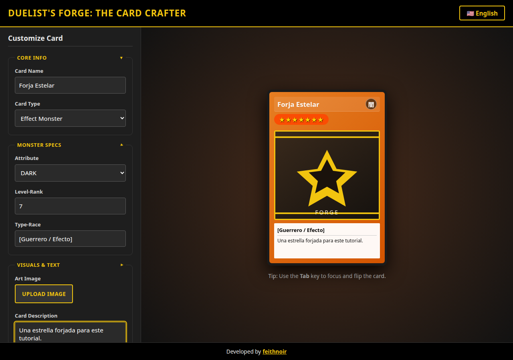

# Duelist's Forge

Aplicación para crear y previsualizar cartas de duelo originales, con editor en vivo y giro 3D. Es la migración a **Angular 22** del prototipo HTML/CSS/JS que sigue en [`legacy/`](legacy/).

No usa arte ni logotipos de Konami. Los marcos son gradientes CSS, el reverso es un sello geométrico propio y el arte vacío es un SVG original.



## Qué conserva del prototipo

- Editor con secciones plegables y campos que aparecen solo en monstruos.
- Ocho tipos de carta, siete atributos y estrellas de nivel (1 a 12).
- Vista previa en vivo, en inglés y en español.
- Giro 3D con clic, Enter o Espacio, y foco con Tab.
- Subida de imagen propia y descarga PNG del frente.
- Diseño oscuro, adaptable y usable con teclado.

## Cómo correrlo

Requiere Node.js 22 o superior y npm 10.

```bash
npm install
npm start
```

Abre `http://127.0.0.1:4200/`. El prototipo viejo se abre aparte:

```bash
cd legacy
python3 -m http.server 8080
```

## Scripts

| Comando                  | Qué hace                                             |
| ------------------------ | ---------------------------------------------------- |
| `npm start`              | Servidor de desarrollo                               |
| `npm test`               | Vitest una vez (`ng test --watch=false`)             |
| `npm run test:watch`     | Vitest en modo observación                           |
| `npm run lint`           | ESLint                                               |
| `npm run format`         | Prettier                                             |
| `npm run build`          | Build de producción en `dist/duelists-forge/browser` |
| `npm run build:gh-pages` | El mismo build con `--base-href /DuelistsForge/`     |

## Documentación

El relato completo de la migración está en [docs/tutorial-angular-duelistsforge.md](docs/tutorial-angular-duelistsforge.md) (serie _De prototipo a Angular_).

Notas por tema, en `docs/files/`:

- [Arquitectura](docs/files/01-arquitectura.md)
- [Modelos y datos](docs/files/02-modelos-y-datos.md)
- [Servicios y estado](docs/files/03-servicios-y-estado.md)
- [Componentes y formulario](docs/files/04-componentes-y-formulario.md)
- [Giro 3D](docs/files/05-efecto-3d.md)
- [Accesibilidad y responsive](docs/files/06-accesibilidad-y-responsive.md)
- [Pruebas y calidad](docs/files/07-pruebas-y-calidad.md)
- [Build y despliegue](docs/files/08-build-y-despliegue.md)
- [Cómo extenderla](docs/files/09-como-extender.md)

## Estructura

```text
legacy/                 prototipo original
public/                 favicon y arte vacío
src/app/core/           modelos, datos, funciones puras, servicios
src/app/shared/         piezas reutilizables
src/app/features/       editor, preview y página de la forja
src/fonts/              subset OFL para los nueve glifos de atributo
docs/                   tutorial, notas y capturas
```

## Licencia

Código bajo [MIT](LICENSE). El subset tipográfico de los glifos está bajo SIL OFL: [src/fonts/OFL.txt](src/fonts/OFL.txt).

Desarrollado por [feithnoir](https://github.com/feithnoir).
