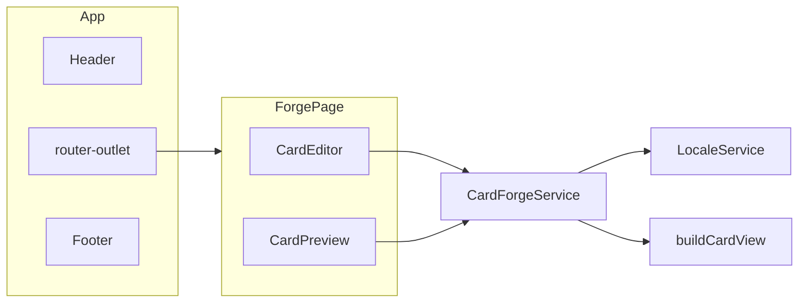

# Arquitectura

Duelist's Forge es una sola pantalla. Aun así el código no vive en un componente gigante: el cascarón, la página y las reglas del dominio están separados.

| Capa            | Responsabilidad                 | No hace                  |
| --------------- | ------------------------------- | ------------------------ |
| `core/models`   | Formas y tipos                  | No lee el DOM            |
| `core/data`     | Catálogos e idiomas             | No decide qué se muestra |
| `core/card`     | Funciones puras de presentación | No guardan estado        |
| `core/services` | Estado y efectos (archivo, PNG) | No arman HTML            |
| `shared`        | Controles genéricos             | No conocen una carta     |
| `features`      | Pantallas                       | No duplican catálogos    |

`App` dibuja encabezado, idioma, outlet y pie. `ForgePage` es la ruta `''` y se carga en diferido. El editor escribe el borrador; la preview solo lee `view()`.

El prototipo anterior sigue en [`legacy/`](../../legacy/) y no entra al build.
