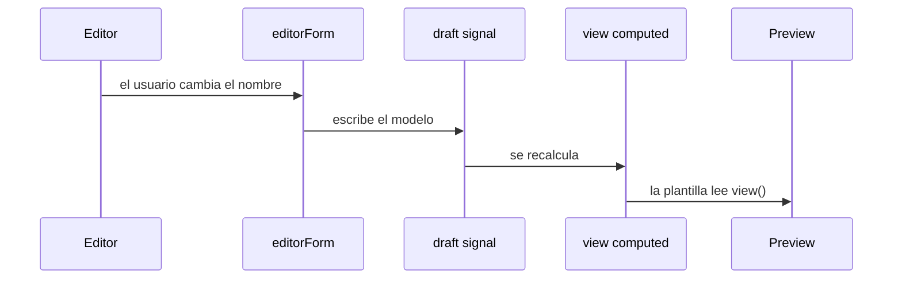

# Servicios y estado

Hay cuatro servicios, todos con `@Service()` (singleton de Angular 22, el reemplazo habitual de `@Injectable({ providedIn: 'root' })`):

| Servicio               | Estado que posee                    | Efecto                                    |
| ---------------------- | ----------------------------------- | ----------------------------------------- |
| `LocaleService`        | `locale`                            | Catálogo de textos                        |
| `CardForgeService`     | `draft`, `artworkUrl`, `editorForm` | `view` calculada                          |
| `ArtworkReaderService` | ninguno                             | Lee un `File` a data URL                  |
| `CardExportService`    | ninguno                             | PNG con html2canvas, cargado al descargar |

`editorForm = form(this.draft, cardDraftSchema)` usa el signal del borrador como única fuente. Lo que el usuario escribe en un `[formField]` actualiza `draft` y, en el mismo ciclo, `view()`.

La imagen no entra al formulario: un data URL grande no aporta validación. `setArtwork` la guarda al lado.

El esquema esconde atributo, nivel y raza cuando el marco no es de monstruo. Un campo oculto no invalida el formulario, así que una carta mágica sigue siendo válida aunque el nivel haya quedado en 0.

