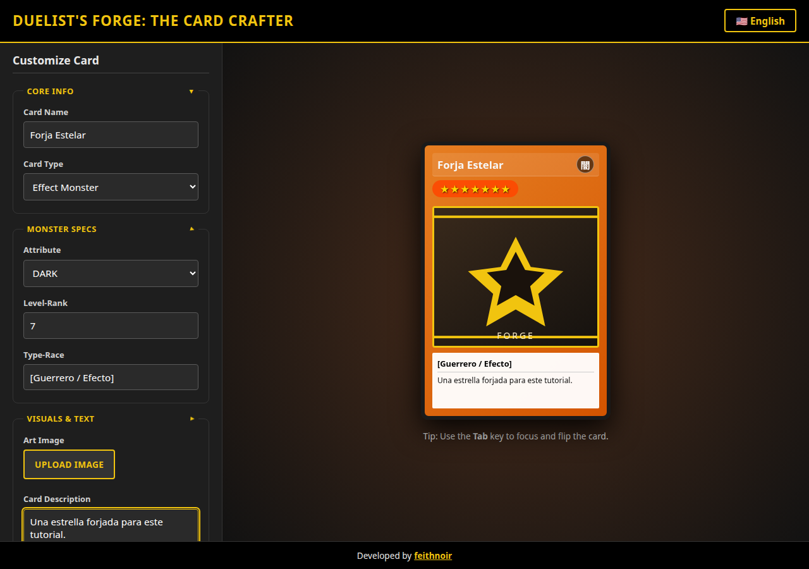

# Componentes y formulario

Todos los componentes son standalone, con `ChangeDetectionStrategy.OnPush` y signals. Angular 22 ya usa OnPush de base; el linter igual pide declararlo.

| Componente       | Selector              | Papel                           |
| ---------------- | --------------------- | ------------------------------- |
| `App`            | `app-root`            | Cascarón e idioma del documento |
| `ForgePage`      | `app-forge`           | Ruta principal                  |
| `CardEditor`     | `app-card-editor`     | Formulario                      |
| `CardPreview`    | `app-card-preview`    | Carta y giro                    |
| `FoldSection`    | `app-fold-section`    | `<fieldset>` plegable           |
| `LanguageSwitch` | `app-language-switch` | Botón de idioma                 |

El formulario es un Signal Form. Cada control lleva `[formField]` apuntando a una rama del árbol (`editor.name`, `editor.frameId`, …). `maxLength`, `min` y `max` viven en `cardDraftSchema`, no en atributos sueltos: la directiva `FormField` escribe `maxlength`, `min` y `max` ella misma y el compilador rechaza enlazarlos otra vez.

Las secciones de monstruo y de visuales nacen cerradas, igual que en el prototipo. La de monstruo además desaparece con `@if (!editor.attributeId().hidden())` en hechizos y trampas.

La página no envía el formulario a ningún servidor. El botón de descarga es `type="button"` y emite `downloadCard`. `ForgePage` toma el elemento del frente con `viewChild` y llama a `CardExportService`.
