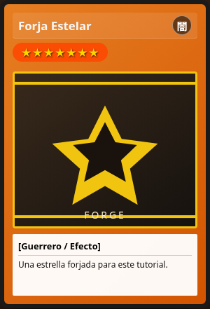
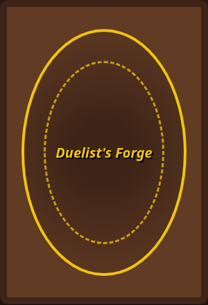

# Giro 3D

El giro es CSS. No hay librería de animación.

1. `.card-container` define `perspective`.
2. `.card` tiene `transform-style: preserve-3d` y una transición de `rotateY`.
3. `.is-flipped` rota el conjunto 180°.
4. `.card-back` nace en `rotateY(180deg)`.
5. `backface-visibility: hidden` oculta la cara que queda detrás.

El estado es un signal local de `CardPreview`: `flipped`. Un clic, Enter o Espacio lo invierte. El contenedor es `role="button"` con `aria-pressed`. Tab lo enfoca; el texto de ayuda lo dice.

`prefers-reduced-motion` anula la transición en `styles.css`. La carta cambia de cara igual, sin animación larga.

La descarga no captura el padre girado. `captureElement()` devuelve el `<article>` del frente, así el PNG sale de frente aunque la carta esté volteada.

El reverso es un sello circular propio con el nombre de la app. No reproduce el dorso oficial de ninguna carta comercial.
