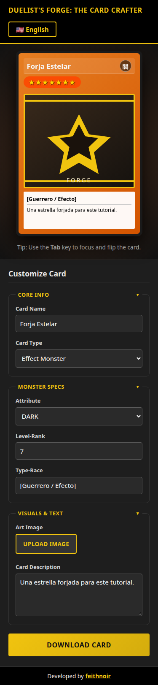

# Accesibilidad y responsive

## Teclado y lectores

- Enlace “saltar al contenido” hacia `#main-content`.
- Cada control del formulario tiene `<label for>`.
- Las secciones usan `<button>` dentro de `<legend>` con `aria-expanded` y `aria-controls`.
- El input de archivo está asociado a su etiqueta y se activa con el botón visible.
- Errores de validación y de lectura de imagen van en `role="alert"`.
- El foco visible es un contorno ámbar, no se elimina el outline sin reemplazo.
- `<html lang>` y `document.title` siguen al idioma activo.

## Medidas

En escritorio la app ocupa `100dvh`: la barra lateral y la vista previa hacen scroll por separado. Bajo 900 px el grid pasa a una columna, primero la carta y después el editor, y el scroll vuelve a la página.

La carta mide `min(300px, 100%)` con `aspect-ratio`, así que en 375 px no empuja el documento a los lados. Inputs y botones usan `max-width: 100%`. El título del encabezado puede partirse (`text-wrap: balance`).

En esa captura, `documentElement.scrollWidth` es igual a `clientWidth` (375).
