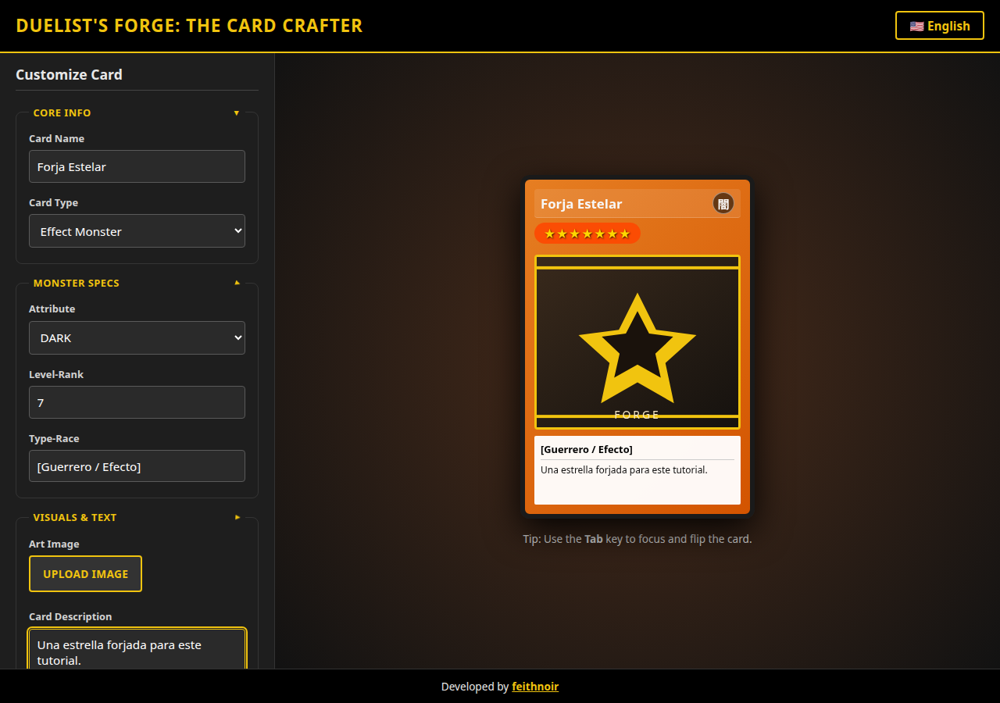
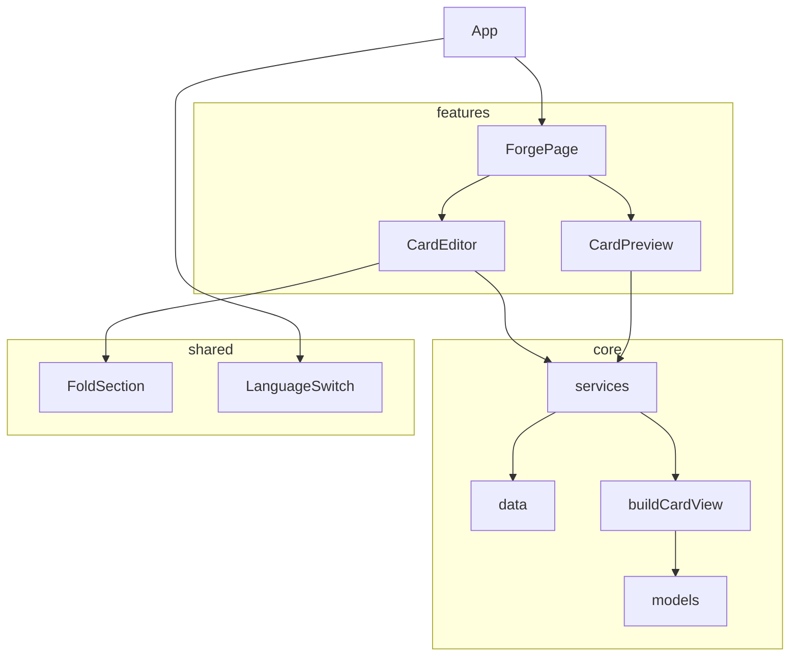
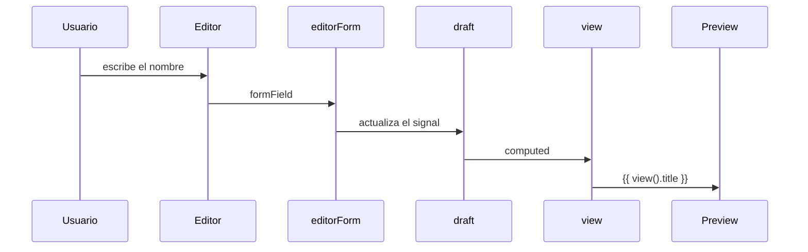
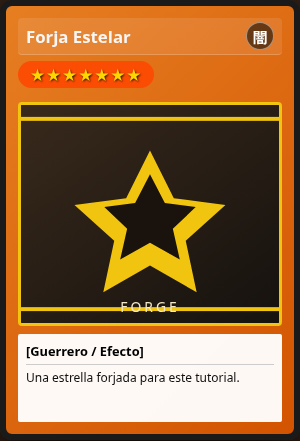
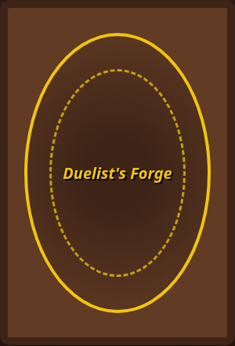
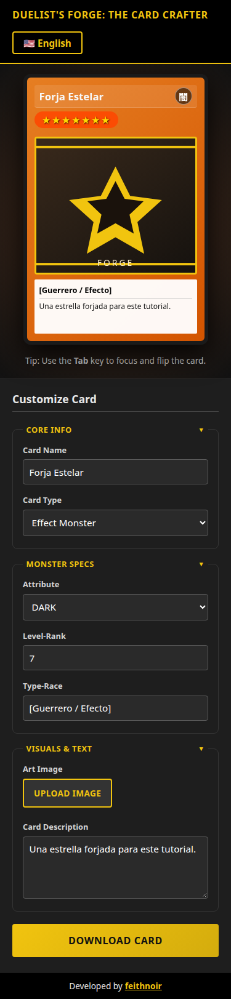

# De un prototipo HTML a Angular 22: cómo migré Duelist's Forge

Soy Hugo Colmenares. Este texto cuenta cómo pasé Duelist's Forge de un solo `index.html` con JavaScript suelto a una aplicación Angular 22. El prototipo ya hacía lo importante: armabas una carta, la veías cambiar y la girabas en 3D. La migración no inventa otro producto. Ordena ese comportamiento para que se pueda probar y extender.

Las capturas de esta nota salen de la app ya migrada.



## Tabla de contenido

1. [Qué había en el prototipo](#1-qué-había-en-el-prototipo)
2. [Prerrequisitos e instalación](#2-prerrequisitos-e-instalación)
3. [Crear el proyecto con ng new](#3-crear-el-proyecto-con-ng-new)
4. [ESLint, Prettier y la librería de exportación](#4-eslint-prettier-y-la-librería-de-exportación)
5. [Dónde quedó el prototipo](#5-dónde-quedó-el-prototipo)
6. [Estructura de carpetas y por qué](#6-estructura-de-carpetas-y-por-qué)
7. [SOLID, DRY y KISS en esta app](#7-solid-dry-y-kiss-en-esta-app)
8. [Convención de nombres](#8-convención-de-nombres)
9. [Modelos e interfaces](#9-modelos-e-interfaces)
10. [Catálogos](#10-catálogos)
11. [La vista de la carta](#11-la-vista-de-la-carta)
12. [Servicios, signals y estado](#12-servicios-signals-y-estado)
13. [Signal Forms en el editor](#13-signal-forms-en-el-editor)
14. [Componentes](#14-componentes)
15. [El giro 3D con CSS](#15-el-giro-3d-con-css)
16. [Enrutamiento](#16-enrutamiento)
17. [Accesibilidad y responsive](#17-accesibilidad-y-responsive)
18. [Pruebas con Vitest](#18-pruebas-con-vitest)
19. [Build y despliegue](#19-build-y-despliegue)
20. [Cómo agregar un tipo de carta](#20-cómo-agregar-un-tipo-de-carta)
21. [Cierre](#cierre)

## 1. Qué había en el prototipo

Tres archivos: `index.html`, `style.css` e `index.js`. Al cargar, el script leía el formulario, escribía el texto en la carta, escondía los campos de monstruo en hechizos y trampas, cambiaba el idioma y descargaba el frente con html2canvas. El giro era una clase CSS, `is-flipped`.

Eso funciona. También mezcla traducción, reglas de la carta y el DOM en un solo listener. Cada campo nuevo obliga a tocar el mismo archivo. Por eso separé datos, reglas, estado y vista, y dejé el prototipo intacto en `legacy/` para poder comparar.

No copié arte ni logotipos de Konami. Los marcos siguen siendo gradientes CSS, el reverso es un sello geométrico con el nombre de la app y el placeholder es un SVG original.

## 2. Prerrequisitos e instalación

Usé Node.js 22 y npm 10. Angular 22 no corre en Node 20.

```bash
node -v
npm -v
```

En mi máquina eso imprimió `v22.23.4` y `10.9.9`. Si el tuyo es más viejo, instala Node 22 desde [nodejs.org](https://nodejs.org/) antes de seguir.

El CLI no hace falta instalarlo global. `npx` baja la versión 22 cuando la pides:

```bash
npx -y @angular/cli@22 version
```

Si lo prefieres global:

```bash
npm install -g @angular/cli@22
ng version
```

Para que el CLI no se detenga a preguntar si puede enviar analítica:

```bash
export NG_CLI_ANALYTICS=false
npx -y @angular/cli@22 analytics off
```

## 3. Crear el proyecto con ng new

El repositorio ya tenía el prototipo en la raíz, y `ng new` no escribe encima de una carpeta ocupada. Moví el prototipo primero (la sección 5) y generé el workspace en un directorio limpio. Si partes de cero, esta es la orden completa. Cada bandera evita una pregunta interactiva:

```bash
npx -y @angular/cli@22 new duelists-forge \
  --directory=. \
  --routing=true \
  --style=css \
  --ssr=false \
  --strict=true \
  --standalone=true \
  --zoneless=true \
  --skip-git=true \
  --test-runner=vitest \
  --defaults
```

Qué significa cada una:

| Bandera                | Por qué la dejé así                                                            |
| ---------------------- | ------------------------------------------------------------------------------ |
| `--directory=.`        | El proyecto queda en la carpeta actual, no en una subcarpeta                   |
| `--routing=true`       | Crea `app.routes.ts` y `provideRouter`                                         |
| `--style=css`          | El prototipo ya era CSS. No metí un preprocesador de más                       |
| `--ssr=false`          | Es una herramienta de cliente. No hay HTML que pre-renderizar                  |
| `--strict=true`        | TypeScript estricto y presupuestos de bundle más cortos                        |
| `--standalone=true`    | Es el default de Angular 22. Lo escribo para que quede en el historial         |
| `--zoneless=true`      | Angular 21+ ya no usa Zone.js en apps nuevas. Los signals avisan cuándo pintar |
| `--skip-git=true`      | El repo git ya existía                                                         |
| `--test-runner=vitest` | Default de Angular 22. Karma sigue existiendo, no lo necesito                  |
| `--defaults`           | Acepta el resto (plantillas externas, CSS externo, prefijo `app`)              |

`--skip-git` también omite el commit inicial del CLI. El historial lo sigo llevando yo.

Angular 22 genera la raíz como `src/app/app.ts`, clase `App`, sin el sufijo `.component.ts`. Esa es la guía de estilo 2025. Los archivos de dominio que escribí a mano sí llevan sufijo cuando el tipo no se adivina: `.model.ts`, `.data.ts`, `.service.ts`. Lo explico en la sección 8.

El `tsconfig.json` que salió del CLI no traía `"strict": true` escrito, aunque varias banderas estrictas ya estaban. Lo agregué, junto con las opciones del compilador de plantillas:

```json
{
  "compilerOptions": {
    "strict": true,
    "noImplicitOverride": true,
    "noPropertyAccessFromIndexSignature": true,
    "noImplicitReturns": true,
    "noFallthroughCasesInSwitch": true
  },
  "angularCompilerOptions": {
    "strictInjectionParameters": true,
    "strictInputAccessModifiers": true,
    "strictInputTypes": true,
    "strictTemplates": true
  }
}
```

Comprueba que arranca:

```bash
npm start
```

`ng serve` queda en `http://127.0.0.1:4200/`. Córtalo con Ctrl+C cuando veas la página de bienvenida. Esa página se reemplaza más adelante.

## 4. ESLint, Prettier y la librería de exportación

Angular 22 ya deja un `.prettierrc` con parser `angular` para las plantillas. ESLint no viene incluido. Lo agregué con el schematic de la misma versión mayor:

```bash
npx ng add angular-eslint --skip-confirmation --defaults
npm install html2canvas
npm install -D eslint-config-prettier
```

Eso crea `eslint.config.js` (flat config, no `.eslintrc`) y un target `lint` en `angular.json`. Al final del arreglo de configuración puse Prettier para que apague reglas de estilo que chocan con el formateador:

```js
const eslint = require('@eslint/js');
const { defineConfig } = require('eslint/config');
const tseslint = require('typescript-eslint');
const angular = require('angular-eslint');
const prettier = require('eslint-config-prettier');

module.exports = defineConfig([
  // ... bloques ts y html que genera el schematic ...
  prettier,
]);
```

`angular-eslint` 22 marca error si un componente no declara `ChangeDetectionStrategy.OnPush` y si no es standalone. Aunque Angular 22 ya usa OnPush por defecto, lo escribo en cada `@Component`. Así el linter y el lector ven la intención.

html2canvas es CommonJS. El build avisa. En `angular.json`, dentro de `projects.duelists-forge.architect.build.options`:

```json
"allowedCommonJsDependencies": ["html2canvas"]
```

Scripts que dejé en `package.json`:

```json
{
  "scripts": {
    "start": "ng serve",
    "build": "ng build",
    "build:gh-pages": "ng build --base-href /DuelistsForge/",
    "test": "ng test --watch=false",
    "test:watch": "ng test",
    "lint": "ng lint",
    "format": "prettier --write .",
    "format:check": "prettier --check ."
  }
}
```

`npm test` no se queda mirando el disco. En una terminal interactiva, `npm run test:watch` sí.

## 5. Dónde quedó el prototipo

```bash
mkdir -p legacy
git mv index.html index.js style.css legacy/
```

`git mv` conserva el historial. Esos tres archivos no los toqué. `legacy/README.md` dice cómo abrirlos:

```bash
cd legacy
python3 -m http.server 8080
```

Angular no los compila. Sirven para comparar el comportamiento mientras migras y para quien quiera ver el punto de partida.

## 6. Estructura de carpetas y por qué

```text
src/app/
  core/
    models/        tipos e interfaces
    data/          catálogos y traducciones
    card/          funciones puras de presentación
    forms/         esquema del Signal Form
    services/      estado y efectos
  shared/
    fold-section/
    language-switch/
  features/
    forge/         página enrutada
    card-editor/
    card-preview/
  app.ts           cascarón
  app.routes.ts
  app.config.ts
public/
  art/placeholder.svg
  favicon.svg
src/fonts/         subset OFL de Noto Sans JP
legacy/            prototipo
docs/
```



`core` no importa de `features`. `shared` no sabe qué es una carta. `features` arma la pantalla. Si mañana hay una ruta de mazo, entra como otra feature y reutiliza el mismo borrador o uno nuevo, sin copiar el formulario.

## 7. SOLID, DRY y KISS en esta app

No las uso como eslogan. Las uso para decidir dónde vive cada cosa.

**Una sola razón para cambiar (S).** `LocaleService` cambia si cambia el idioma. `CardExportService` cambia si cambia la captura PNG. `buildCardView` cambia si cambia lo que se lee en la carta. El editor no contiene ninguna de esas reglas: solo enlaza controles.

**Abierto a un marco nuevo, cerrado en el componente (O).** Un tipo de carta nuevo es una fila del catálogo, una traducción y una regla CSS. El `@if` del editor pregunta `hidden()`, no una lista de strings copiada en la plantilla.

**La plantilla depende de `CardView`, no de los detalles (L e I).** La preview no pregunta "¿esto es un hechizo?" para decidir el glifo. Recibe `attributeGlyph` y `showMonsterStats`. Puedo cambiar la regla en la función pura y la plantilla sigue igual.

**Dependencias hacia dentro (D).** Los componentes piden servicios con `inject()`. Los tests sustituyen el entorno de `TestBed` sin construir el DOM a mano para las reglas.

**DRY.** Los ids existen una vez (`CARD_FRAME_IDS`). El `Record` que los describe tiene que cubrirlos todos. Las traducciones comparten `Messages`. El nombre del archivo PNG es una función, y el servicio de export la llama: no hay dos formas de slugificar.

**KISS.** No hay store genérico, ni NgRx, ni un motor de plantillas de cartas. Hay un signal, un formulario y una función. El giro es una clase CSS. La segunda ruta no existe todavía: el router ya está, con una ruta y un comodín.

## 8. Convención de nombres

| Artefacto           | Clase o símbolo                             | Archivo                 |
| ------------------- | ------------------------------------------- | ----------------------- |
| Id estable          | `CardFrameId`, `AttributeId`, `LocaleId`    | `*.model.ts`            |
| Borrador editable   | `CardDraft`                                 | `card-draft.model.ts`   |
| Lo que se pinta     | `CardView`                                  | `card-view.model.ts`    |
| Catálogo            | `CARD_FRAMES`, `ATTRIBUTES`, `TRANSLATIONS` | `*.data.ts`             |
| Regla de formulario | `cardDraftSchema`                           | `card-draft.schema.ts`  |
| Servicio            | `CardForgeService`                          | `card-forge.service.ts` |
| Componente          | `CardEditor`                                | `card-editor.ts`        |
| Página enrutada     | `ForgePage`                                 | `forge.ts`              |

Los componentes siguen la guía 2025: la clase no termina en `Component` y el archivo no lleva `.component.ts`. Los servicios sí llevan `Service` en la clase y `.service.ts` en el archivo, porque `@Service()` no se distingue de un componente si solo miras el nombre de la carpeta.

Los ids de atributo (`DARK`, `LIGHT`, …) no se traducen. El texto visible sale de `Messages`. Así un borrador guardado mañana no depende del idioma en el que se escribió.

## 9. Modelos e interfaces

`src/app/core/models/card-draft.model.ts`:

```ts
import type { AttributeId } from './attribute.model';
import type { CardFrameId } from './card-frame.model';

export const CARD_NAME_MAX_LENGTH = 30;
export const CARD_LEVEL_MIN = 1;
export const CARD_LEVEL_MAX = 12;

export interface CardDraft {
  name: string;
  frameId: CardFrameId;
  attributeId: AttributeId;
  level: number | null;
  race: string;
  description: string;
}

export const EMPTY_CARD_DRAFT: CardDraft = {
  name: '',
  frameId: 'monster-effect',
  attributeId: 'DARK',
  level: 7,
  race: '',
  description: '',
};
```

El nivel es `number | null` porque un `<input type="number">` vacío no es un número. La cadena vacía en nombre, raza o descripción significa "usa el texto del idioma activo". La imagen no está aquí: es un data URL y no se valida como el resto.

`CardFrameId` sale del arreglo, no de una unión escrita a mano:

```ts
export const CARD_FRAME_IDS = [
  'monster-normal',
  'monster-effect',
  'monster-synchro',
  'monster-xyz',
  'monster-pendulum',
  'monster-link',
  'spell',
  'trap',
] as const;

export type CardFrameId = (typeof CARD_FRAME_IDS)[number];
export type CardFrameGroup = 'monster' | 'spell' | 'trap';

export interface CardFrameDefinition {
  readonly id: CardFrameId;
  readonly labelKey: keyof Messages;
  readonly group: CardFrameGroup;
}

export function isMonsterFrame(
  frameId: CardFrameId,
): frameId is Exclude<CardFrameId, 'spell' | 'trap'> {
  return frameGroup(frameId) === 'monster';
}

export function frameGroup(frameId: CardFrameId): CardFrameGroup {
  if (frameId === 'spell' || frameId === 'trap') {
    return frameId;
  }
  return 'monster';
}
```

`Messages` lista cada texto de la interfaz (`pageTitle`, `btnDownload`, `defaultCardName`, …). `labelKey` es `keyof Messages`, así que un marco no puede apuntar a una llave que no existe. El archivo completo está en `src/app/core/models/messages.model.ts`.

`CardView` es el contrato de la preview. La plantilla no recalcula estrellas:

```ts
export interface CardView {
  readonly title: string;
  readonly race: string;
  readonly description: string;
  readonly frameId: CardFrameId;
  readonly showMonsterStats: boolean;
  readonly stars: string;
  readonly level: number;
  readonly levelAria: string;
  readonly attributeGlyph: string;
  readonly attributeAria: string;
  readonly artworkUrl: string;
}
```

## 10. Catálogos

El detalle de cada marco es un `Record` exhaustivo. Si agregas un id y olvidas la fila, el compilador se detiene.

```ts
const CARD_FRAME_DETAILS = {
  'monster-normal': { labelKey: 'optMonsterNormal', group: 'monster' },
  'monster-effect': { labelKey: 'optMonsterEffect', group: 'monster' },
  'monster-synchro': { labelKey: 'optMonsterSynchro', group: 'monster' },
  'monster-xyz': { labelKey: 'optMonsterXyz', group: 'monster' },
  'monster-pendulum': { labelKey: 'optMonsterPendulum', group: 'monster' },
  'monster-link': { labelKey: 'optMonsterLink', group: 'monster' },
  spell: { labelKey: 'optSpell', group: 'spell' },
  trap: { labelKey: 'optTrap', group: 'trap' },
} as const satisfies Record<CardFrameId, FrameDetail>;

export const CARD_FRAMES: readonly CardFrameDefinition[] = CARD_FRAME_IDS.map((id) => ({
  id,
  labelKey: CARD_FRAME_DETAILS[id].labelKey,
  group: CARD_FRAME_DETAILS[id].group,
}));
```

Los atributos repiten el mismo truco con glifo y llave de traducción. Los glifos (`闇`, `光`, `地`, `水`, `炎`, `風`, `神`, y `魔` / `罠` para mágica y trampa) son caracteres, los mismos que ya mostraba el prototipo. No son imágenes oficiales. Para que se vean aunque el sistema no tenga una fuente CJK, embebí un subset de Noto Sans JP (SIL OFL, ver `src/fonts/OFL.txt`) y lo aplico solo en la medalla:

```css
@font-face {
  font-family: 'Forge Marks';
  src: url('./fonts/noto-sans-jp-marks.ttf') format('truetype');
  font-weight: 700;
  font-style: normal;
  font-display: swap;
}
```

Las traducciones:

```ts
const EN_MESSAGES = {
  pageTitle: "Duelist's Forge: The Card Crafter",
  btnDownload: 'Download Card',
  defaultCardName: 'Dark Magician',
  // ...el resto de las llaves de Messages
} as const satisfies Messages;

export const TRANSLATIONS: Record<LocaleId, Messages> = {
  en: EN_MESSAGES,
  es: ES_MESSAGES,
};
```

`satisfies Messages` exige todas las llaves y conserva el objeto literal. El español usa las cadenas del prototipo ("Monstruo de Sincronía", "Carta Mágica") más los textos nuevos de error y de quitar imagen. La interfaz habla en segunda persona del singular: "Elige un archivo", "Intenta de nuevo".

## 11. La vista de la carta

`buildCardView` es pura. Mismos argumentos, mismo resultado. Por eso el spec no necesita `TestBed`.

```ts
export function clampLevel(level: number | null): number {
  if (level === null || !Number.isFinite(level)) {
    return 0;
  }
  return Math.max(0, Math.min(CARD_LEVEL_MAX, Math.trunc(level)));
}

export function displayText(value: string, fallback: string): string {
  const trimmed = value.trim();
  return trimmed.length > 0 ? trimmed : fallback;
}

export function buildCardView(
  draft: CardDraft,
  artworkUrl: string | null,
  messages: Messages,
): CardView {
  const level = clampLevel(draft.level);
  const monster = isMonsterFrame(draft.frameId);
  const attribute = monster ? attributeById(draft.attributeId) : null;
  const spell = draft.frameId === 'spell';

  return {
    title: displayText(draft.name, messages.defaultCardName),
    race: displayText(draft.race, messages.defaultCardRace),
    description: displayText(draft.description, messages.defaultCardText),
    frameId: draft.frameId,
    showMonsterStats: monster,
    stars: '★'.repeat(level),
    level,
    levelAria: messages.levelAria.replace('{level}', String(level)),
    attributeGlyph: attribute ? attribute.glyph : spell ? SPELL_GLYPH : TRAP_GLYPH,
    attributeAria: attribute
      ? `${messages.attrAria}: ${messages[attribute.labelKey]}`
      : spell
        ? messages.optSpell
        : messages.optTrap,
    artworkUrl: artworkUrl ?? PLACEHOLDER_ARTWORK_URL,
  };
}
```

En el repositorio la función hace dos `return` (monstruo y el resto) para no anidar ternarios. El listado de arriba es la misma decisión en corto: hechizo y trampa esconden estrellas, muestran su glifo y siguen enseñando la raza por defecto, igual que el prototipo, que nunca ocultaba esa línea.

`cardFileName` arma el PNG:

```ts
export function cardFileName(title: string): string {
  const slug = title
    .normalize('NFKD')
    .replace(/[\u0300-\u036f]/g, '')
    .replace(/[^\p{L}\p{N}]+/gu, '_')
    .replace(/^_+|_+$/g, '');
  return `${slug || 'card'}_Card.png`;
}
```

`Mago Oscuro` termina en `Mago_Oscuro_Card.png`. Un título hecho solo de signos cae en `card_Card.png`.

## 12. Servicios, signals y estado

`@Service()` registra la clase en el inyector raíz. Es el reemplazo, en Angular 22, de `@Injectable({ providedIn: 'root' })` para un singleton simple.

Idioma:

```ts
import { computed, Service, signal } from '@angular/core';
import { TRANSLATIONS } from '../data/translations.data';
import type { LocaleId } from '../models/locale.model';

@Service()
export class LocaleService {
  readonly locale = signal<LocaleId>('en');
  readonly messages = computed(() => TRANSLATIONS[this.locale()]);

  toggle(): void {
    this.locale.update((current) => (current === 'en' ? 'es' : 'en'));
  }

  setLocale(locale: LocaleId): void {
    this.locale.set(locale);
  }
}
```

La forja junta borrador, formulario y vista:

```ts
@Service()
export class CardForgeService {
  private readonly locale = inject(LocaleService);

  readonly draft = signal<CardDraft>({ ...EMPTY_CARD_DRAFT });
  readonly artworkUrl = signal<string | null>(null);
  readonly editorForm = form(this.draft, cardDraftSchema);
  readonly view = computed(() =>
    buildCardView(this.draft(), this.artworkUrl(), this.locale.messages()),
  );

  setArtwork(url: string | null): void {
    this.artworkUrl.set(url);
  }
}
```

`form()` llama a `inject()` por dentro, así que tiene que nacer en un contexto de inyección. Un campo de un `@Service` lo es. El formulario no copia el modelo: escribe en el mismo signal. `view` se entera sola.



La lectura de la imagen es otro servicio, sin estado. Rechaza lo que no sea `image/*` y lo que pase de 5 MB. Devuelve un data URL. El editor guarda el motivo del fallo en un signal local (`type`, `size` o `read`) y lo anuncia con `role="alert"`.

La exportación carga html2canvas recién al hacer clic. El editor no paga esos 200 kB al abrir:

```ts
@Service()
export class CardExportService {
  async downloadElement(element: HTMLElement, title: string): Promise<void> {
    const { default: html2canvas } = await import('html2canvas');
    const canvas = await html2canvas(element, {
      useCORS: true,
      scale: 2,
      backgroundColor: null,
    });
    const link = document.createElement('a');
    link.download = cardFileName(title);
    link.href = canvas.toDataURL('image/png');
    link.click();
  }
}
```

`ForgePage` es quien une el botón con el elemento. El servicio no busca nodos por id: recibe el nodo. Eso es lo que el prototipo hacía con `getElementById`, sacado de en medio.

## 13. Signal Forms en el editor

Signal Forms salió estable en Angular 22. El esquema se declara una vez:

```ts
import { hidden, max, maxLength, min, schema } from '@angular/forms/signals';

export const cardDraftSchema = schema<CardDraft>((path) => {
  maxLength(path.name, CARD_NAME_MAX_LENGTH);
  min(path.level, CARD_LEVEL_MIN, {
    when: ({ valueOf }) => isMonsterFrame(valueOf(path.frameId)),
  });
  max(path.level, CARD_LEVEL_MAX, {
    when: ({ valueOf }) => isMonsterFrame(valueOf(path.frameId)),
  });
  hidden(path.attributeId, {
    when: ({ valueOf }) => !isMonsterFrame(valueOf(path.frameId)),
  });
  hidden(path.level, {
    when: ({ valueOf }) => !isMonsterFrame(valueOf(path.frameId)),
  });
  hidden(path.race, {
    when: ({ valueOf }) => !isMonsterFrame(valueOf(path.frameId)),
  });
});
```

`when` recibe `valueOf`. No leas el signal del borrador ahí dentro: la función de lógica tiene que depender de los paths para volver a correr cuando el marco cambie.

Un campo `hidden()` no aporta validez al padre. Una carta mágica sigue siendo válida aunque el nivel haya quedado fuera de rango. `min` y `max` del nivel también están detrás de `when`, por la misma razón.

En la plantilla, `FormField` se importa en el componente y se enlaza así:

```html
<label for="card-name">{{ messages().labelName }}</label>
<input
  id="card-name"
  type="text"
  [formField]="editor.name"
  [placeholder]="messages().placeholderName"
  [attr.aria-invalid]="editor.name().invalid()"
/>
@if (editor.name().touched() && editor.name().invalid()) {
<p id="name-error" class="field-error" role="alert">{{ messages().errorNameLength }}</p>
}
```

No pongas `[attr.maxlength]`, `[attr.min]` ni `[attr.max]` en un control que ya tiene `formField`. El compilador lo rechaza (`NG8022`): la directiva escribe esos atributos desde el esquema. Me pasó en el primer build.

El grupo de monstruo:

```html
@if (!editor.attributeId().hidden()) {
<app-fold-section [title]="messages().legendMonster" [startCollapsed]="true">
  <!-- atributo, nivel y raza -->
</app-fold-section>
}
```

Los `<select>` recorren los catálogos:

```html
<select id="card-frame" [formField]="editor.frameId">
  @for (frame of frames; track frame.id) {
  <option [value]="frame.id">{{ messages()[frame.labelKey] }}</option>
  }
</select>
```

El formulario no se envía a ningún lado:

```html
<form autocomplete="off" (submit)="$event.preventDefault()"></form>
```

El botón de descarga es `type="button"`. Emite un `output()` hacia la página, que es la dueña del DOM de la carta y del flag `exporting`.

## 14. Componentes

Todos llevan `changeDetection: ChangeDetectionStrategy.OnPush`. Los miembros que usa la plantilla son `protected`. El resto, `private`.

`FoldSection` es el fieldset plegable. `linkedSignal` arranca del input `startCollapsed` (monstruo y visuales nacen cerrados, como en el prototipo). El botón vive dentro de `<legend>` y publica `aria-expanded` y `aria-controls`. Enter y Espacio vienen gratis porque es un `<button>`.

`LanguageSwitch` llama a `locale.toggle()`. El texto del botón es el idioma actual (`🇺🇸 English` / `🇲🇽 Español`). El `aria-label` dice "Switch language" o "Cambiar idioma".

`CardEditor` inyecta la forja, el idioma y el lector de archivos. `editor` es un alias de `editorForm` para que la plantilla no atraviese tres propiedades. Al elegir un archivo:

```ts
protected async onArtworkSelected(event: Event): Promise<void> {
  if (!(event.target instanceof HTMLInputElement)) {
    return;
  }
  const file = event.target.files?.item(0) ?? null;
  event.target.value = '';
  if (!file) {
    return;
  }
  try {
    this.forge.setArtwork(await this.artworkReader.read(file));
    this.artworkIssue.set(null);
  } catch (error: unknown) {
    const reason = error instanceof ArtworkReadError ? error.reason : 'read';
    this.artworkIssue.set(reason);
  }
}
```

Limpiar `input.value` permite elegir el mismo archivo dos veces. Si hay arte, aparece "Quitar imagen". El prototipo no lo tenía; sin eso, la única forma de volver al placeholder era recargar.

`CardPreview` lee `view()` y guarda el giro en un signal propio. El giro es presentación, no parte del borrador: no quieres que un PNG "recuerde" que la carta estaba de espaldas.

`ForgePage` pide la preview con `viewChild.required(CardPreview)` y, al descargar, le pide el `<article>` del frente. Si html2canvas falla, `exportFailed` muestra el aviso y el botón se rehabilita en el `finally`.

`App` no conoce la carta. Pinta el salto, el encabezado, el outlet y el pie. Un `effect` mantiene el documento alineado con el idioma:

```ts
constructor() {
  effect(() => {
    document.title = this.messages().pageTitle;
    document.documentElement.lang = this.locale.locale();
  });
}
```

El `effect` va en el constructor porque ahí todavía hay contexto de inyección.

## 15. El giro 3D con CSS

El HTML de las dos caras:

```html
<div
  class="card-container"
  tabindex="0"
  role="button"
  [attr.aria-pressed]="flipped()"
  [attr.aria-label]="messages().ariaPreview"
  (click)="toggleFlip()"
  (keydown)="onPreviewKey($event)"
>
  <div class="card" [class.is-flipped]="flipped()">
    <article #front class="card-face card-front" [attr.data-frame]="view().frameId">
      <!-- nombre, atributo, estrellas, imagen, texto -->
    </article>
    <article class="card-face card-back">
      <div class="back-seal">
        <p class="back-title">{{ messages().backTitle }}</p>
      </div>
    </article>
  </div>
</div>
```

No uses `[class]="view().frameId"`. Ese binding pisa las clases estáticas. `data-frame` convive con `card-face` y `card-front`, y el CSS elige el gradiente:

```css
.card-container {
  width: min(var(--card-width), 100%);
  aspect-ratio: 300 / 440;
  perspective: 1200px;
}

.card {
  width: 100%;
  height: 100%;
  position: relative;
  transform-style: preserve-3d;
  transition: transform 0.8s cubic-bezier(0.175, 0.885, 0.32, 1.2);
}

.card.is-flipped {
  transform: rotateY(180deg);
}

.card-face {
  position: absolute;
  inset: 0;
  backface-visibility: hidden;
  border-radius: 12px;
  overflow: hidden;
}

.card-back {
  transform: rotateY(180deg);
}

.card-front[data-frame='monster-effect'] {
  background: linear-gradient(135deg, #e67e22, #d35400);
}
.card-front[data-frame='spell'] {
  background: linear-gradient(135deg, #0e7c6b, #1abc9c);
}
.card-front[data-frame='trap'] {
  background: linear-gradient(135deg, #8e44ad, #9b59b6);
}
```

El teclado:

```ts
protected onPreviewKey(event: KeyboardEvent): void {
  if (event.key === 'Enter' || event.key === ' ') {
    event.preventDefault();
    this.toggleFlip();
  }
}
```

`preventDefault` en la barra espaciadora evita que la página scrollee. Tab solo enfoca; Enter o Espacio giran. El texto de ayuda lo dice, con espacios alrededor de la palabra Tab (en la primera pasada quedaron pegados: "theTab").

Las estrellas se esconden con `visibility: hidden`, no con `@if`, para que el alto de la carta no salte al pasar a una mágica. `aria-hidden` acompaña a esa visibilidad para que el lector no anuncie un nivel que no se ve.

`prefers-reduced-motion: reduce` en `styles.css` deja la transición en casi cero. La cara cambia igual.





La descarga usa `#front`, el article del frente, no el padre que tiene `rotateY`. html2canvas no entiende bien el 3D, y el prototipo ya capturaba el frente a propósito.

## 16. Enrutamiento

`src/app/app.config.ts`:

```ts
import { ApplicationConfig, provideBrowserGlobalErrorListeners } from '@angular/core';
import { provideRouter } from '@angular/router';
import { routes } from './app.routes';

export const appConfig: ApplicationConfig = {
  providers: [provideBrowserGlobalErrorListeners(), provideRouter(routes)],
};
```

`src/app/app.routes.ts`:

```ts
import { Routes } from '@angular/router';

export const routes: Routes = [
  {
    path: '',
    loadComponent: () => import('./features/forge/forge').then((module) => module.ForgePage),
  },
  { path: '**', redirectTo: '' },
];
```

`loadComponent` deja el editor y la preview en un chunk aparte (`forge` en el build). El cascarón llega primero. No hay título de ruta: el `effect` de `App` es el dueño de `document.title`, y un `title` en la ruta lo pisaría al navegar.

`main.ts` no cambió respecto del que genera el CLI:

```ts
import { bootstrapApplication } from '@angular/platform-browser';
import { appConfig } from './app/app.config';
import { App } from './app/app';

bootstrapApplication(App, appConfig).catch((err) => console.error(err));
```

En el test de `App` el router no navega solo. Hay que pedirlo:

```ts
const router = TestBed.inject(Router);
await router.navigateByUrl('/');
await fixture.whenStable();
```

Sin eso, `#card-name` no está porque el chunk perezoso no cargó. Me falló el primer spec por eso.

El grid no puede depender de que el outlet envuelva la página: el componente enrutado queda como hermano de `<router-outlet />`. En `app.css` mando ese hermano a la fila del medio:

```css
:host {
  display: grid;
  grid-template-rows: auto minmax(0, 1fr) auto;
  height: 100dvh;
  overflow: hidden;
}

:host > :not(header):not(footer):not(router-outlet):not(.skip-link) {
  grid-row: 2;
  min-width: 0;
  min-height: 0;
}

router-outlet {
  display: none;
}
```

`ForgePage` parte esa fila en sidebar y preview. Bajo 900 px, tanto el cascarón como la página pasan a una columna y el scroll vuelve al documento. Primero la carta, después el formulario, como el prototipo.

## 17. Accesibilidad y responsive

Lo que revisé contra el prototipo y dejé más explícito:

- Enlace de salto a `#main-content`, y el `<main>` tiene `tabindex="-1"` para que el salto pueda enfocarlo.
- Cada control tiene etiqueta. El archivo usa `<label for="card-art">` aunque el input esté visualmente oculto.
- Las secciones plegables son botones, no un `<legend>` con `click` suelto.
- Errores en `role="alert"`, asociados con `aria-describedby` cuando existen.
- Foco visible en ámbar. No dejé `outline: none` sin reemplazo.
- Contraste del texto de etiqueta subido a `#d2d2d2` sobre el fondo `#1e1e1e`.
- La medalla de atributo fuerza color blanco. En el marco claro de sincronía, el texto heredado quedaba oscuro sobre el círculo oscuro.
- `color-scheme: dark` para que el navegador pinte controles nativos en oscuro.
- La carta usa `min(300px, 100%)`. A 375 px de ancho, `scrollWidth` del documento queda en 375. Lo medí en el navegador.



El título largo del encabezado puede partirse (`clamp` en el tamaño y `text-wrap: balance`). En el prototipo, un `nowrap` implícito del flex era el primer candidato a scroll horizontal.

## 18. Pruebas con Vitest

No instalé Karma ni Jasmine. `ng test` usa el builder `@angular/build:unit-test`. Los spec importan `describe`, `it` y `expect` desde `vitest` para que se lea de dónde salen; el `tsconfig.spec.json` también incluye `vitest/globals`.

Las reglas puras se prueban sin cama de Angular:

```ts
it('hides monster stats on spell and trap frames', () => {
  const spell = buildCardView({ ...EMPTY_CARD_DRAFT, frameId: 'spell' }, null, TRANSLATIONS.en);
  expect(spell.showMonsterStats).toBe(false);
  expect(spell.attributeGlyph).toBe('魔');
});
```

El servicio del formulario sí necesita `TestBed`, porque `form()` inyecta el `Injector` y crea un effect:

```ts
TestBed.configureTestingModule({});
const forge = TestBed.inject(CardForgeService);
TestBed.flushEffects();

forge.editorForm.frameId().value.set('spell');
TestBed.flushEffects();

expect(forge.editorForm.level().hidden()).toBe(true);
expect(forge.editorForm().valid()).toBe(true);
```

Escribo el campo con `.value.set`, no reemplazando el objeto del signal a mano. El formulario es quien publica el cambio; el signal del borrador se entera por ese camino.

La preview, con el DOM de jsdom:

```bash
npm test
```

Ese comando es `ng test --watch=false`. En esta migración quedan 10 archivos y 21 pruebas, todas en verde. El spec de la preview dispara un clic y un `keydown` con Enter, y mira la clase `is-flipped` y `aria-pressed`.

Lint y build, en ese orden cuando cierro un cambio:

```bash
npm run lint
npm run format:check
npm run build
```

`ng build` deja el resultado en `dist/duelists-forge/browser`. En el build de producción que corrí, el chunk inicial queda cerca de 242 kB sin comprimir (unos 69 kB transferidos) y html2canvas viaja aparte, en un chunk perezoso de unos 203 kB.

## 19. Build y despliegue

Desarrollo:

```bash
npm start
```

Producción local, para mirar el resultado real:

```bash
npm run build
npx ng serve --configuration=production
```

O sirve la carpeta con cualquier estático:

```bash
npx --yes serve dist/duelists-forge/browser
```

### Vercel, plan gratis

En la raíz dejé `vercel.json`:

```json
{
  "rewrites": [{ "source": "/(.*)", "destination": "/index.html" }]
}
```

Con una sola ruta el servidor ya entrega `index.html` en `/`. El rewrite importa cuando agregues `/mazos` u otra ruta y alguien la abra directo.

```bash
npm install -g vercel
vercel login
vercel
```

En el asistente: framework Angular si te lo ofrece, o "Other". Comando de build: `npm run build`. Directorio de salida: `dist/duelists-forge/browser`. No hace falta variable de entorno. El plan Hobby alcanza para este sitio estático.

### GitHub Pages

El repositorio es `FeithNoir/DuelistsForge`, así que el sitio vive en `https://feithnoir.github.io/DuelistsForge/` y la base no es `/`.

```bash
npm run build:gh-pages
npx angular-cli-ghpages --dir=dist/duelists-forge/browser
```

`build:gh-pages` es `ng build --base-href /DuelistsForge/`. El arte vacío (`art/placeholder.svg`) es relativo y obedece a `<base href>`. La fuente, referenciada desde el CSS, se resuelve contra la URL del stylesheet, que también queda bajo ese prefijo.

En GitHub: Settings, Pages, rama `gh-pages`, carpeta raíz. No mezcles esta rama con `main`.

Si el nombre del repositorio cambiara, cambia el `--base-href` del script y vuelve a publicar. En Vercel déjalo en `/`.

## 20. Cómo agregar un tipo de carta

Quiero un monstruo de ritual, de color propio, con atributo y estrellas. No creo un componente. El grupo `monster` ya enciende los campos.

1. En `card-frame.model.ts`, agrega el id **antes** de `'spell'`:

```ts
export const CARD_FRAME_IDS = [
  'monster-normal',
  'monster-effect',
  'monster-synchro',
  'monster-xyz',
  'monster-pendulum',
  'monster-link',
  'monster-ritual',
  'spell',
  'trap',
] as const;
```

2. En `messages.model.ts`, la llave nueva:

```ts
optMonsterRitual: string;
```

3. En `translations.data.ts`, los dos idiomas. Si falta uno, `satisfies Messages` no compila.

```ts
// en
optMonsterRitual: 'Ritual Monster',
// es
optMonsterRitual: 'Monstruo de Ritual',
```

4. En `card-frames.data.ts`:

```ts
'monster-ritual': { labelKey: 'optMonsterRitual', group: 'monster' },
```

5. En `card-preview.css`:

```css
.card-front[data-frame='monster-ritual'] {
  background: linear-gradient(135deg, #4a235a, #6c3483);
}
```

6. Corre las pruebas. El spec de catálogos compara la lista de ids con `CARD_FRAMES`. Si el `Record` está incompleto, ni llegas a Vitest: falla `tsc`.

```bash
npm test
npm run lint
```

`isMonsterFrame` mira `group`, no el prefijo del string. Un marco con `group: 'spell'` esconde nivel y atributo aunque el id no diga `spell`. Esa es la extensión que el diseño deja abierta sin tocar el editor.

Para un idioma nuevo el camino es el mismo: un valor en `LOCALE_IDS`, un objeto que cumpla `Messages` y un botón que llame a `setLocale`. No hace falta otro servicio.

## Cierre

El prototipo sigue en `legacy/`, por si quieres ver el antes. La app de ahora abre con `npm start`, se prueba con `npm test` y se publica con el build de producción. El estado cabe en dos signals y un formulario. La carta gira con CSS. Y un tipo nuevo es una fila, no una reescritura.

Si sigues esta serie, el próximo paso natural es guardar varias cartas en `localStorage` sin meter esa persistencia dentro de `buildCardView`. El borrador ya es un objeto plano: se puede serializar tal cual.
